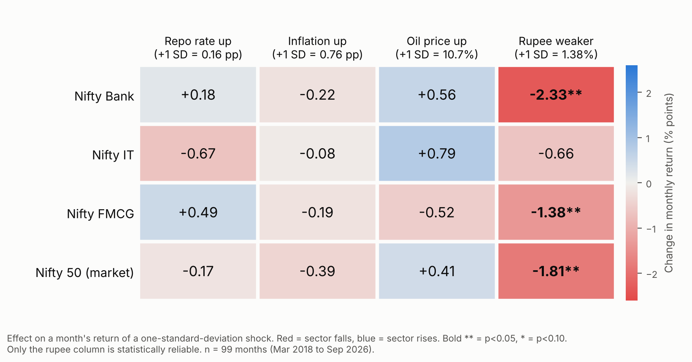
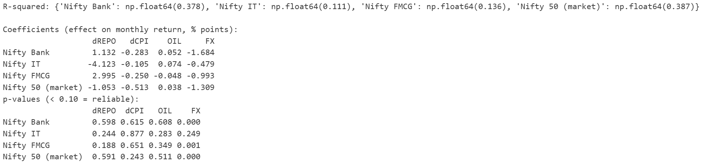
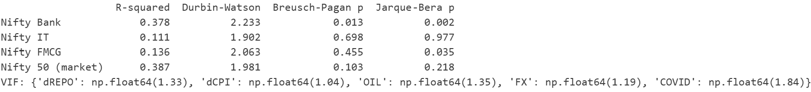
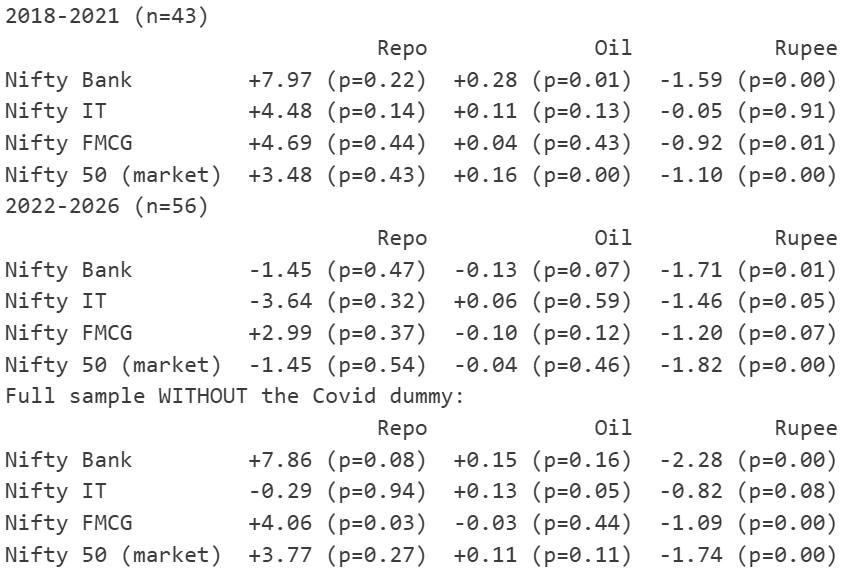
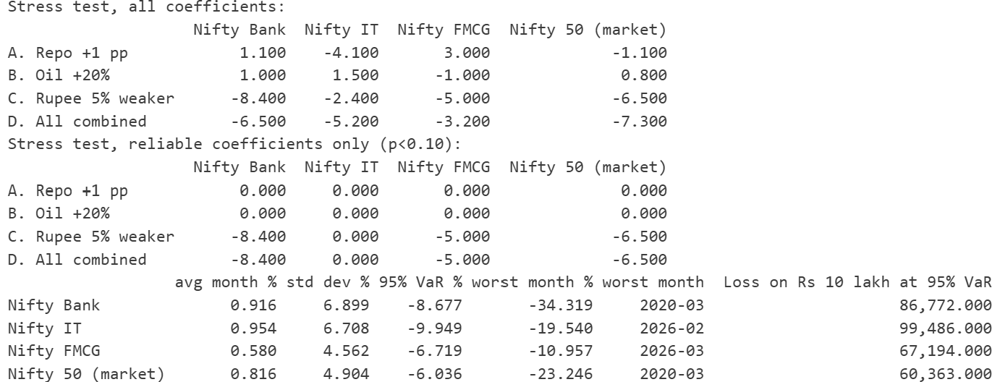
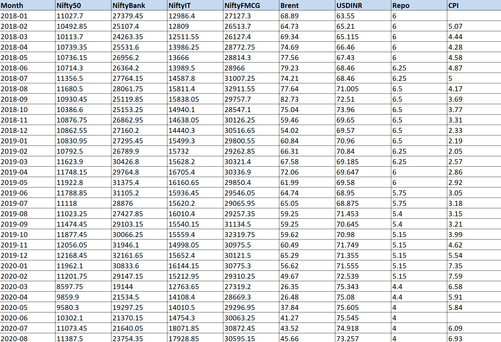

# Macro Shocks and Indian Sectors

How exposed are Indian sectors (Banking, IT, FMCG, plus the Nifty 50) to macro shocks: the RBI repo rate, inflation, oil and the rupee? Monthly data, March 2018 to September 2026 (99 usable months).

## 1. Summary

- **Question:** Which sector's share prices move most when the repo rate, inflation, oil or the rupee changes?
- **Data:** Monthly closes for Nifty Bank, IT, FMCG and Nifty 50, plus Brent oil, USD/INR, the RBI repo rate and CPI inflation. Raw data is kept in one Excel file and analysed in Python (Google Colab).
- **Method:** For each sector, an OLS regression of monthly return on the monthly change in each shock, with Newey-West (HAC) robust standard errors, a Covid-month dummy, diagnostics, a sub-period stability check, a stress test and a historical 95% VaR.
- **Finding:** The rupee is the only statistically reliable factor. A 1% weaker rupee (USD/INR up) is linked with a fall in that month's return of about **1.7 points for Banking, 1.3 for the Nifty 50 and 1.0 for FMCG**. IT is not significant (-0.5, p = 0.25). Repo rate, inflation and oil show no reliable effect.
- **Conclusion:** Banking is the most macro-fragile sector: largest rupee effect, deepest crash in the sample (-34% in March 2020) and a 95% monthly VaR of about -8.7%.

| Sector | Rupee effect (% pts per 1% weaker rupee) | p-value | R-squared | 95% monthly VaR |
|---|---|---|---|---|
| Nifty Bank | -1.68 | < 0.001 | 0.38 | -8.7% |
| Nifty IT | -0.48 | 0.25 | 0.11 | -9.9% |
| Nifty FMCG | -0.99 | 0.001 | 0.14 | -6.7% |
| Nifty 50 | -1.31 | < 0.001 | 0.39 | -6.0% |


**[Excel File Link](https://drive.google.com/drive/folders/16u-0KE5nbFxyePLNtWumXjpz40JPPLNo?usp=sharing)** &ensp; &ensp; _(click to open)_

---

## 2. Screenshots

Save these in an `screenshots/` folder and keep the file names below so the links work.


*Heatmap of the effect of a one-standard-deviation shock on each sector's monthly return; only the rupee column is strongly coloured and significant.*
-

*Regression coefficients and p-values for every sector and shock, showing that only the rupee coefficients have p < 0.10 (except IT).*
-

*Model checks (R-squared, Durbin-Watson, Breusch-Pagan, Jarque-Bera, VIF) showing no autocorrelation or multicollinearity problem.*
-

*The same regressions run separately for 2018-2021 and 2022-2026, and without the Covid dummy, showing the rupee effect holds in both periods.*
-

*Stress-test losses for a 5% weaker rupee and the 95% historical VaR for each sector.*
-

*The first rows of the Excel raw-data sheet (Month, Nifty50, NiftyBank, NiftyIT, NiftyFMCG, Brent, USDINR, Repo, CPI).*

## 3. Files in this repository

| File | What it contains |
|---|---|
| `Project3 Raw Data Excel File Link` | The raw monthly data (Jan 2018 to Sep 2026, 105 rows): index closes, Brent, USD/INR, month-end repo rate and CPI inflation as announced. No formulas; this is the only input. |
| `Regression Data Excel File Link` | The cleaned 99-month sample actually used in the regressions: monthly returns, shock changes and the Covid dummy. |
| `macro_shock_analysis.ipynb` | The Google Colab / Jupyter notebook with every step explained and all outputs and the heatmap saved inside, so it can be read on GitHub without running anything. |
| `macro_shock_analysis.py` | The same analysis as one plain Python script. It reads the Excel file and saves the results as CSV files and the heatmap. |
| `Macro_Shock_Report.pdf` | A 4-page written report: question, data, method, results, stability checks, stress test and limitations. |
| `screenshots/heatmap.png` | The main chart: effect of a one-standard-deviation shock on each sector. |

Suggested layout:

```
macro-shock-model/
  README.md
  Project3_Raw_Data.xlsx
  macro_shock_analysis.ipynb
  macro_shock_analysis.py
  regression_data.csv
  Macro_Shock_Report.pdf
  screenshots/          (heatmap.png and the screenshots above)
```

## 4. How to run

1. **Colab:** open the notebook in Google Colab, upload `Project3_Raw_Data.xlsx` using the folder icon, then Runtime > Run all.
2. **Locally:** put the Excel file and script in one folder, run `pip install pandas numpy statsmodels matplotlib openpyxl`, then `python macro_shock_analysis.py`.

## 5. Method in brief

- **Changes, not levels:** index, oil and USD/INR as % change; repo rate and CPI as change in percentage points.
- **Regression per sector:** return = constant + b1 x repo change + b2 x CPI change + b3 x oil % + b4 x USD/INR % + b5 x Covid dummy (March 2020).
- **Robust inference:** Newey-West HAC standard errors (3 lags); a coefficient is "reliable" at p < 0.10.
- **Sample:** 105 months in the raw file; 99 used. The first month has no change; May-July 2020 (CPI not normally published during lockdown) and February 2026 (CPI base-year change) are excluded.
- **Timing:** CPI is placed in the month it was announced; the repo rate is the level in force at month end (assumed 6.00% for January 2018).
- **Comparison across shocks:** coefficient x standard deviation of the shock (1 SD: repo 0.16 pp, CPI 0.76 pp, oil 10.7%, USD/INR 1.4%).

**Data sources:** Investing.com (index, Brent and USD/INR monthly prices), RBI (repo rate decisions), Trading Economics (CPI year-on-year release calendar).

## 6. Limitations

- **Small sample.** About 100 monthly observations, so estimates are imprecise and weak effects cannot be separated from noise. "Not significant" means "not detected here", not "no effect".
- **Correlation, not causation.** The rupee effect is probably a proxy for foreign portfolio flows and risk sentiment; that explanation is my interpretation and was not tested.
- **Judgement calls matter.** Without the Covid dummy, Banking's repo coefficient turns +7.86 (reverse causation: RBI cut rates while the market was crashing). The excluded months and the dummy are my choices and are disclosed.
- **Little repo variation.** The repo rate changed in only 18 of 99 months, and markets price expected moves before the announcement, so a same-month change does not capture the surprise.
- **Linear, constant model.** One coefficient per shock for the whole period; the oil effect changes sign between 2018-2021 and 2022-2026, so it is not dependable. Residuals for Banking and FMCG are not normal (fat tails), which is why robust standard errors are used.
- **Only three sectors**, measured by market-cap-weighted indices that are dominated by a few large stocks; results may not hold for individual companies.
- **Stress test is a linear extrapolation** of past relationships, and the 95% VaR is a historical estimate that includes the Covid crash; neither is a ceiling on losses.
- **Equity returns are not credit quality.** This is a market-sensitivity view, not a default or rating analysis.
- **Data handling.** Raw data was collected manually from public websites and checked against each source's percentage changes; October 2026 is excluded because the month was incomplete.
